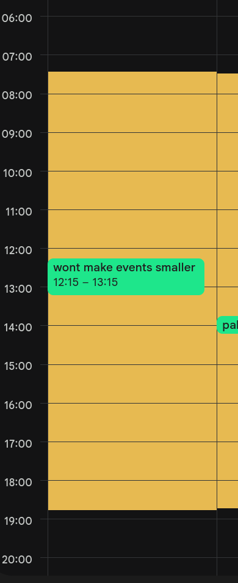

# Google Calendar - Daylight Column Highlights

A lightweight, zero-dependency Tampermonkey userscript that dynamically calculates and renders daylight/twilight hours directly onto your Google Calendar grid view (`Day`, `4-Day`, and `Week` views).

It uses standard astronomical solar calculations (NOAA solar model) to accurately display daytime blocks for your specific geographic location and timezone without interfering with event positioning, dimensions, or drag-and-drop behavior.

---

## Features

- **Per-Day Accuracy**: Every day column calculates its own exact sunrise and sunset times based on the date. Navigating to past or future weeks automatically displays the correct seasonal solar bands.
- **Zero Event Interference**: Renders as a `pointer-events: none` background overlay, keeping your events, grid interactions, and layout sizing 100% untouched.
- **Clean Structure**: Excludes all-day event rows and top date header cards—only the vertical time grid receives the background highlight.
- **Customizable Twilight Modes**: Choose between Official Sunrise/Sunset, Civil Twilight, Nautical Twilight, or Astronomical Twilight via a custom floating UI dialog.
- **Resilient Persistence**: Stores settings in both Tampermonkey storage (`GM_setValue`) and browser `localStorage` so your custom coordinates and preferences survive script updates and reloads.

---

## Installation

1. Install a userscript manager extension in your browser:
   - [Tampermonkey](https://www.tampermonkey.net/) (Recommended)
   - [Violentmonkey](https://violentmonkey.github.io/)
2. Click the link below to install the script directly:
   - **[Install google-calendar-daylight.user.js](https://raw.githubusercontent.com/allanlaal/google-calendar-daylight/main/google-calendar-daylight.user.js)**
3. Open or refresh [Google Calendar](https://calendar.google.com).

---

## Configuration & Settings

Access the script settings directly from the extension menu (Tampermonkey icon → *Google Calendar - Per-Day Daylight Highlights*):

1. **Change Twilight Type**: Opens a custom dialog to select solar calculation boundaries:
   - **Official Daylight (0°)**: Sun center is above the horizon. Full daylight.
   - **Civil Twilight (-6°, Default)**: Enough natural light to navigate outdoors without streetlights.
   - **Nautical Twilight (-12°)**: Horizon is visible at sea; navigation stars appear.
   - **Astronomical Twilight (-18°)**: Complete sky darkness boundary; faint stars visible.
2. **Set Timezone**: Auto-detects system timezone via `Intl.DateTimeFormat`; supports fallback IANA timezones (e.g., `Europe/Tallinn`).
3. **Set Coordinates**: Set custom latitude and longitude coordinates for hyper-local accuracy.

---

## License

[MIT](LICENSE)
